<a href="https://mohamed-sabith.netlify.app/">
  
</a>

  <a href="https://mohamed-sabith.netlify.app/">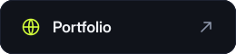</a>&nbsp;
  <a href="https://www.linkedin.com/in/mohamed-sabith-mp">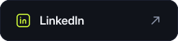</a>&nbsp;
  <a href="https://github.com/mohamedsabith">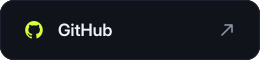</a>&nbsp;
  <a href="mailto:mohamedsabithmp@gmail.com">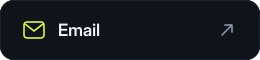</a>

 

<picture>
  <source media="(prefers-color-scheme: light)" srcset="./assets/title-about-light.svg" />
  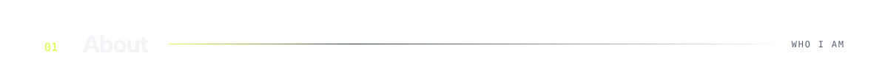
</picture>
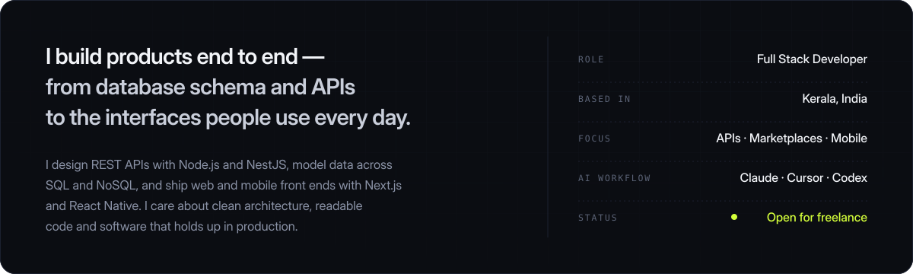

 

<picture>
  <source media="(prefers-color-scheme: light)" srcset="./assets/title-stack-light.svg" />
  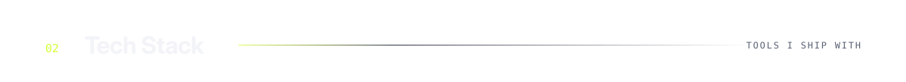
</picture>
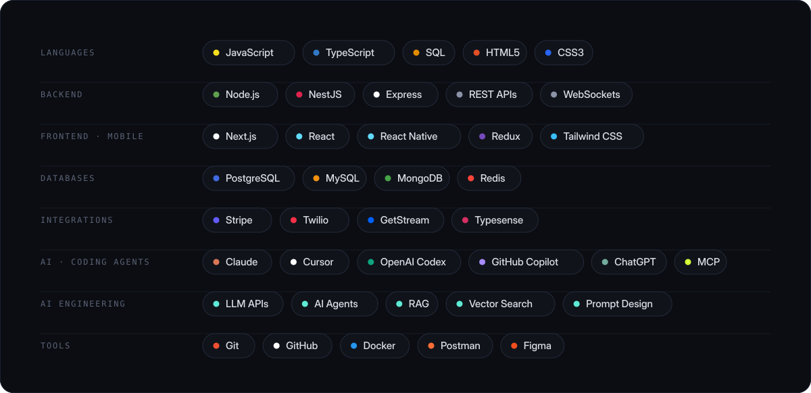

 

<picture>
  <source media="(prefers-color-scheme: light)" srcset="./assets/title-ai-light.svg" />
  
</picture>

 

<picture>
  <source media="(prefers-color-scheme: light)" srcset="./assets/title-work-light.svg" />
  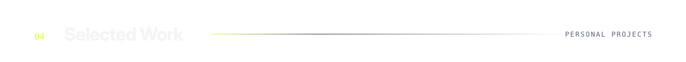
</picture>

  <a href="https://github.com/mohamedsabith/nextjs-food-delivery-app">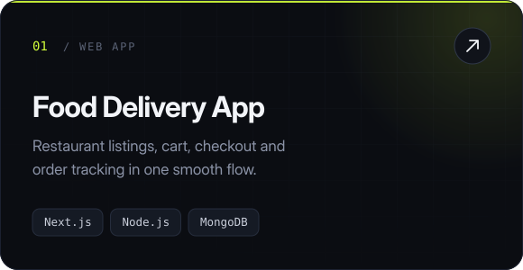</a>
  <a href="https://github.com/mohamedsabith?tab=repositories">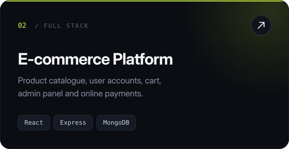</a>

  <a href="https://github.com/mohamedsabith/student-management">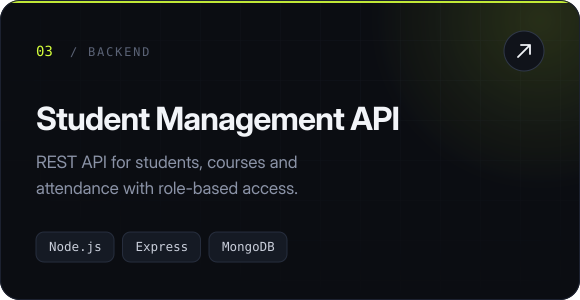</a>
  <a href="https://github.com/mohamedsabith/instagram-like-automation">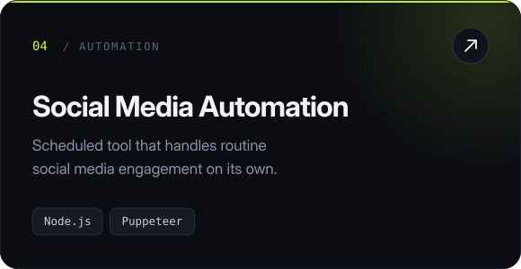</a>

 

<picture>
  <source media="(prefers-color-scheme: light)" srcset="./assets/title-activity-light.svg" />
  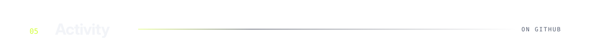
</picture>

  
  

 

<picture>
  <source media="(prefers-color-scheme: light)" srcset="./assets/title-contact-light.svg" />
  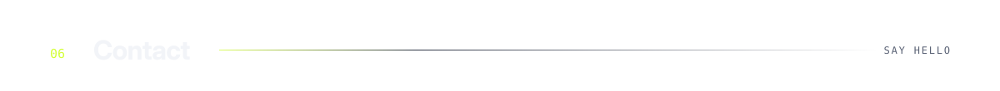
</picture>
<a href="mailto:mohamedsabithmp@gmail.com">
  
</a>

<picture>
  <source media="(prefers-color-scheme: light)" srcset="./assets/footer-light.svg" />
  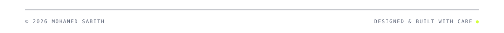
</picture>
